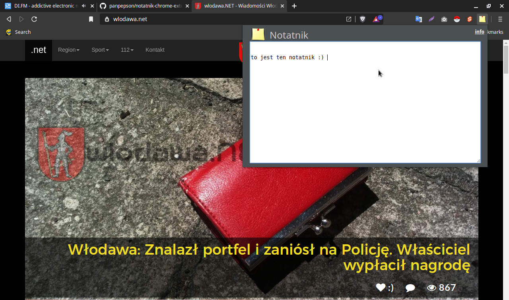

# Notatnik

WEB
https://chrome.google.com/webstore/detail/notatnik/peemaifpdcjdlpkkocnfdcboofdjlmfk

## 🆕 Nowe funkcje / New Features

### PL
- **Menu rozwijane** — jeden przycisk "Menu" z dostępem do: Info (GitHub), Eksport, Import
- **Eksport do TXT** — pobiera notatkę jako plik `notatnik-YYYY-MM-DD.txt` (UTF-8)
- **Import z TXT** — wczytuje plik tekstowy i nadpisuje aktualną notatkę (z potwierdzeniem)
- **Wskaźnik zapisu** — status w prawym dolnym rogu: "Zapisywanie…" → "Zapisano ✓" / "Błąd!"
- **Skrót Escape** — zamyka menu rozwijane

### EN
- **Dropdown menu** — single "Menu" button with: Info (GitHub), Export, Import
- **Export to TXT** — downloads note as `notatnik-YYYY-MM-DD.txt` (UTF-8)
- **Import from TXT** — loads text file and overwrites current note (with confirmation)
- **Save indicator** — status in bottom-right: "Saving…" → "Saved ✓" / "Error!"
- **Escape shortcut** — closes dropdown menu

## Uwaga!

nic **WAŻNEGO** nie trzymaj w notatniku!
Ponieważ notatniki używa pamięci podręcznej Twojej przeglądarki.
Mówiąc w skrócie - nie ma przeglądarki - nie ma notatek!
Ten notatnik przechowując notatki ad hoc do śmierci notatki, albo przeglądarki - Miłego używania ツ

## Instalacja

- Skopiuj plik repozytorium np jako zip, albo git clone,
- Rozpakuj na dysk zawartosc archiwum, ale tak aby wszytko było w folderze - jeśli użyłeś gita pomiń ten punkt,
- Następnie w pasek adresowym przegladarki wpisz <chrome://extensions>
- Nastpenie po lewiej stronie będzie taki napis - **Załaduj rozpakowane** - poradzisz sobie :)

- # Miłego używania ツ

## 🏴󠁧󠁢󠁥󠁮󠁧󠁿 Note!

Don’t keep anything **IMPORTANT** in this notebook!
It relies on your browser’s cache, so in short—no browser, no notes!
This notebook is meant for quick, temporary notes, which last only as long as the note or browser does. Happy note-taking ツ

## Installation

- Copy the repository files, either by downloading as a zip or using git clone.
- Extract the contents of the archive to your drive, ensuring everything stays in one folder. (If you used git clone, you can skip this step.)
- In your browser’s address bar, type <chrome://extensions>.
- On the left side, you’ll see a button labeled Load unpacked—you’ll handle this part just fine!

## Enjoy ツ

  

